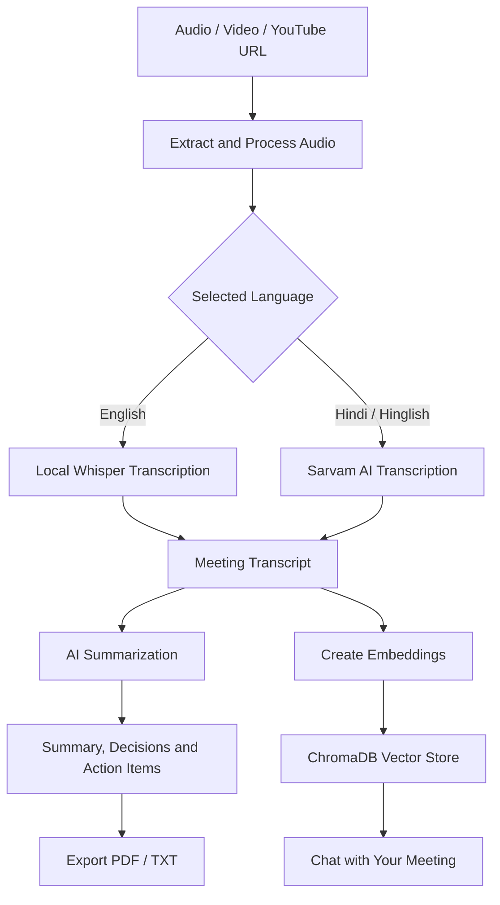

# 🎙️ MeetScribe — AI Meeting Assistant

**Turn conversations into clear summaries, decisions, and actionable tasks.**

MeetScribe is an AI-powered meeting assistant that transforms audio, video, and YouTube content into structured meeting notes. It combines speech-to-text transcription, AI-generated summaries, action-item extraction, and retrieval-augmented generation (RAG) to help you understand and revisit important conversations.

\<p align="center">

🚀 **[Try MeetScribe Live](https://meetscribe-5hb8tg2mhdvfehkhpmod5u.streamlit.app/)**

\</p>

---

## ✨ Features

- 🎧 **Multiple Input Sources** — Upload local audio/video files or provide a YouTube URL.
- 🗣️ **AI-Powered Transcription** — Transcribe English audio locally using OpenAI Whisper and process Hindi/Hinglish audio using Sarvam AI.
- 📝 **Smart Meeting Summaries** — Convert lengthy transcripts into concise, structured notes.
- ✅ **Action Item Extraction** — Identify follow-up tasks, owners, and deadlines when available in the conversation.
- 🎯 **Key Decisions** — Extract important decisions made during a meeting.
- ❓ **Open Questions** — Highlight unresolved questions and follow-ups.
- 💬 **Chat with Your Meeting** — Ask questions about a transcript using a RAG pipeline powered by ChromaDB.
- 📄 **Export Reports** — Generate downloadable meeting reports in PDF and TXT formats.

## 🎯 Why MeetScribe?

Manually reviewing long recordings and writing meeting notes can be time-consuming. MeetScribe helps reduce that effort by organizing conversations into information that is easier to review and act on.

**The goal:** Spend less time taking notes and more time acting on what matters.

## 🛠️ Tech Stack

| Technology                              | Purpose                                                                               |
| --------------------------------------- | ------------------------------------------------------------------------------------- |
| Python                                  | Core application logic                                                                |
| Streamlit                               | Interactive web interface                                                             |
| OpenAI Whisper                          | Local speech transcription for English                                                |
| Sarvam AI                               | Hindi/Hinglish speech processing                                                      |
| LangChain                               | LLM orchestration and RAG workflow                                                    |
| Google Gemini / configured LLM provider | AI-generated summaries and structured insights, depending on the active configuration |
| ChromaDB                                | Vector storage for transcript retrieval                                               |
| Sentence Transformers / Hugging Face    | Text embeddings                                                                       |
| FFmpeg and Pydub                        | Audio/video processing                                                                |
| ReportLab / FPDF2                       | PDF report generation                                                                 |
| python-dotenv                           | Local environment variable configuration                                              |

## ⚙️ How It Works



*The exact processing path depends on the selected language and the application's current configuration.*

## 🚀 Try the Live Demo

You can try the deployed application without setting up the project locally.

**👉 [Launch MeetScribe](https://meetscribe-5hb8tg2mhdvfehkhpmod5u.streamlit.app/)**

Typical workflow:

1. Open the application.
2. Upload a supported local audio/video file or enter a YouTube URL.
3. Select the appropriate transcription language, if prompted.
4. Start processing and wait for the transcript.
5. Review the generated summary, action items, decisions, and open questions.
6. Ask questions about the meeting or export the report, where supported.

*Processing time and feature availability depend on the input length, selected transcription service, configured API access, and deployment resources.*

## 💻 Run Locally

### Prerequisites

- Python 3.10 or later; Python 3.12 is a suitable starting point for this project.
- Git
- FFmpeg installed and available on your system PATH
- API credentials for the external AI services you intend to use

### 1. Clone the repository

```bash
git clone https://github.com/Ayush-star848/MeetScribe.git
cd MeetScribe
```

### 2. Create a virtual environment

**Windows — PowerShell**

```powershell
python -m venv .venv
.\.venv\Scripts\Activate.ps1
```

If PowerShell blocks activation, you can use Command Prompt or invoke the environment's Python directly.

**macOS / Linux**

```bash
python3 -m venv .venv
source .venv/bin/activate
```

### 3. Install dependencies

Make sure your dependency file is named `requirements.txt` and is located in the repository root.

```bash
python -m pip install --upgrade pip
python -m pip install -r requirements.txt
```

Install FFmpeg separately if it is not already installed. Verify the installation with:

```bash
ffmpeg -version
```

### 4. Configure environment variables

Create a `.env` file in the project root. Add only the credentials required by the providers configured in your code.

```env
GOOGLE_API_KEY=your_google_api_key
SARVAM_API_KEY=your_sarvam_api_key
WHISPER_MODEL=small
SARVAM_STT_MODEL=saaras:v2.5
```

Replace the placeholder values with your own credentials. Confirm the exact variable names in your configuration and source code before running the application.

**Security:** Never commit `.env`, API keys, or other credentials to GitHub. For deployment, configure secrets through the hosting platform's secrets manager.

### 5. Start the application

```bash
streamlit run app.py
```

Streamlit will display a local URL in the terminal, usually:

```text
http://localhost:8501
```

Open that URL in your browser.

## 📁 Project Structure

The following is a simplified overview; the exact files may vary as development continues.

```text
MeetScribe/
├── app.py                  # Streamlit user interface
├── main.py                 # Meeting-processing pipeline
├── core/
│   ├── extractor.py        # Audio/video or YouTube extraction
│   ├── transcriber.py      # Speech-to-text processing
│   ├── summarizer.py       # Meeting summaries and insights
│   └── vector_store.py     # Vector database and retrieval
├── utils/
│   └── audio_processor.py  # Audio processing utilities
├── requirements.txt        # Python dependencies
├── .env                    # Local secrets (not committed)
├── .gitignore
└── README.md
```

## 🔐 Privacy and API Usage

- Local Whisper transcription can keep English transcription processing on your machine when running locally.
- Sarvam AI and configured LLM providers may process submitted content through their external services.
- Cloud deployment runs on remote infrastructure and may have different resource and privacy characteristics from local execution.
- Avoid uploading confidential meeting recordings unless you have permission and understand the relevant provider's data-handling policies.
- Keep API credentials out of source code, commits, screenshots, and public issue reports.

## ⚠️ Current Limitations

- Transcription accuracy depends on audio quality, background noise, accents, and language selection.
- YouTube extraction may be affected by source availability, access restrictions, or platform changes.
- Long recordings can take significant time and memory to process.
- Local Whisper and embedding models may need additional disk space, CPU, or RAM.
- Cloud deployments can have different resource limits and dependency compatibility from a local computer.
- AI-generated summaries and action items should be reviewed for accuracy, especially when owners or deadlines are inferred from conversation context.

## 🗺️ Future Improvements

Potential directions for further development include:

- [ ] Support for more languages and automatic language detection.
- [ ] Speaker identification and diarization.
- [ ] Timestamps and speaker attribution for action items.
- [ ] Improved processing of long recordings.
- [ ] Searchable meeting history and persistent storage.
- [ ] More export formats and customizable report templates.
- [ ] Improved error handling, automated tests, and deployment monitoring.

## 🤝 Contributing

Suggestions, bug reports, and improvements are welcome.

1. Fork the repository.
2. Create a feature branch.
3. Make and test your changes.
4. Submit a pull request describing the improvement.

For bugs, include the relevant error message and reproduction steps. Never include API keys, confidential recordings, or private transcripts.

## 👨‍💻 Author

**Ayush Gupta**

- GitHub: [@Ayush-star848](https://github.com/Ayush-star848)
- Project repository: [MeetScribe on GitHub](https://github.com/Ayush-star848/MeetScribe)
- Live application: [MeetScribe — Streamlit](https://meetscribe-5hb8tg2mhdvfehkhpmod5u.streamlit.app/)

## 📜 License

See the [LICENSE](LICENSE) file in this repository for licensing terms.

---

\<p align="center">
&#x20; \<b>MeetScribe — From conversations to clarity. 🎙️\</b>
\</p>
